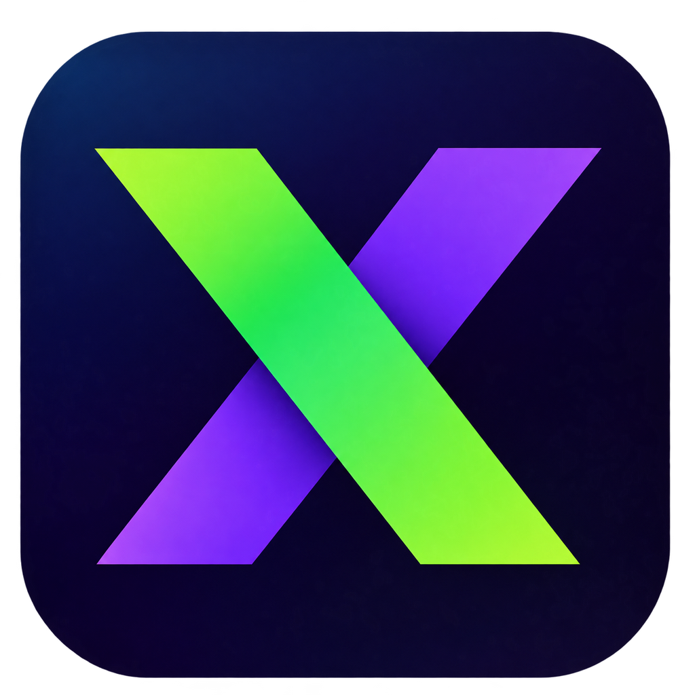

# XORA

<p align="center"></p>

**Emulador Android ligero, fluido y modular para Windows y Linux.** XORA ejecuta aplicaciones Android dentro de su ventana principal por defecto, adapta el rendimiento al equipo y permite configurar perfiles de dispositivo, mando, teclado, mouse y DPI.

> XORA 0.6.11 integra la instalación directa de APK, la identidad nueva, la interfaz en español, el indicador de red, la recuperación automática de ADB, Google Play predeterminado y el actualizador seguro. Las validaciones externas de hardware y publicación siguen documentadas en el [plan maestro](docs/XORA-PLAN.md).

## Características

- **Instalación de APK:** importa un APK, analiza sus datos y crea una entrada en la biblioteca.
- **Ventanas independientes:** cada aplicación puede abrirse, redimensionarse, girarse y cerrarse como una aplicación de escritorio.
- **Perfiles automáticos:** PC básica, portátil, PC de alto rendimiento, teléfono preconfigurado, teléfono gaming, tableta y perfil personalizado.
- **Rendimiento configurable:** modos de ahorro, equilibrado y máximo rendimiento, con control de CPU, GPU, RAM, FPS y temperatura.
- **Controles para juegos:** perfiles de mando, teclado, mouse, sensibilidad y DPI.
- **Archivos compartidos:** intercambio bidireccional entre una carpeta del equipo y el almacenamiento Android.
- **Diagnóstico:** comprobación de aceleración, controladores, memoria, almacenamiento, red y estado del runtime.
- **Google Play predeterminado:** la imagen oficial incluye Play Store y Servicios de Google verificados; Play Juegos y otros paquetes adicionales siguen siendo opcionales.
- **Interfaz en español:** la interfaz, el manual, los avisos y los mensajes dinámicos pasan por el sistema `i18n`.

## Arquitectura

```text
Interfaz XORA (HTML/CSS/JS)
        │
        ▼
Proceso principal Electron
  ventanas · bandeja · perfiles · APK · diagnósticos · actualizaciones
        │
        ▼
Runtime Android
  imagen base · datos de usuario · red · controles · complementos
```

La interfaz no ejecuta comandos del sistema directamente. Las operaciones de procesos, archivos, red e instalación pasan por el proceso principal y se validan en el límite del módulo.

## Requisitos de desarrollo

- Windows 10/11 x64 o Linux compatible.
- Node.js 20 o posterior.
- npm.
- Para las pruebas de runtime: Android Emulator, ADB y una imagen Android compatible.

## Inicio rápido

```powershell
npm install
npm start
```

Para ejecutar el conjunto de pruebas:

```powershell
npm test
```

La prueba de idioma comprueba que el contenido público principal no vuelva a incluir caracteres chinos.

## Estructura principal

| Ruta | Responsabilidad |
|---|---|
| `src/ui/` | Ventanas, estilos, manual e internacionalización |
| `src/core/` | APK, ADB, runtime, perfiles, red y diagnósticos |
| `src/main.js` | Proceso principal, ventanas, bandeja y eventos |
| `src/preload.js` | Canales permitidos entre interfaz y proceso principal |
| `engine/` | Runtime local; los binarios pesados no se versionan |
| `test/` | Pruebas unitarias, de integración y de idioma |
| `docs/` | Arquitectura, manual y plan de producto |

## Actualizaciones

El repositorio privado de GitHub es la fuente de código y de Releases de XORA. El flujo previsto es:

1. CI ejecuta las pruebas y la auditoría de dependencias.
2. El instalador y los paquetes del runtime se construyen para cada plataforma.
3. Cada artefacto se publica con hash y manifiesto de versión.
4. El cliente verifica plataforma, versión, hash y firma antes de instalar.
5. Una comprobación posterior confirma la actualización; si falla, se recupera la versión anterior.

No se incluirán tokens personales de GitHub dentro del instalador. Para más detalle, consulta el apartado de actualizaciones del [plan maestro de XORA](docs/XORA-PLAN.md).

## Complementos de Google

Google Play Store y los Servicios de Google vienen incluidos y verificados en la imagen oficial predeterminada. Google Play Juegos y otros paquetes adicionales son opcionales. La aplicación muestra estados precisos como `No instalado`, `Disponible para instalar`, `Instalado` o `Reparación necesaria`; nunca afirma que un componente está activo sin verificarlo.

## Documentación

- [Plan maestro de XORA](docs/XORA-PLAN.md)
- [Arquitectura](docs/ARCHITECTURE.md)
- [Manual de usuario](docs/USER-MANUAL.md)
- [Guía de contribución](CONTRIBUTING.md)
- [Política de privacidad](docs/privacy.md)

## Contribuir

Antes de enviar cambios:

```powershell
npm test
git diff --check
```

Las contribuciones deben mantener los contratos entre módulos, validar entradas externas, evitar secretos en el repositorio y añadir pruebas para cualquier comportamiento nuevo.

## Estado del proyecto

XORA tiene implementada la base funcional del plan: aplicación de escritorio, runtime Android, biblioteca de APK, interfaz y avisos en español, perfiles, rendimiento, controles, Google Play predeterminado y contrato de actualización firmado. Antes de una distribución pública todavía deben hacerse las pruebas con hardware físico, configurar el secreto de firma y publicar instaladores firmados.

## Licencia

Este proyecto se distribuye bajo la licencia MIT. Consulta [LICENSE](LICENSE).
